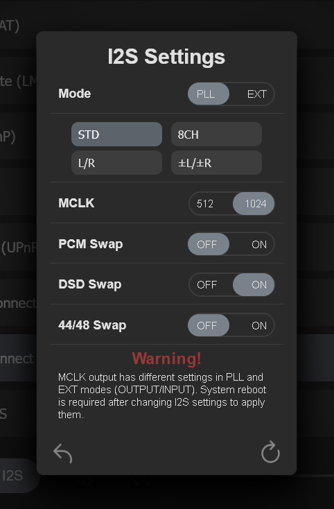

# PureFox

**Network audio endpoint on Luckfox Pico Max / Ultra with external clock support**

> This is a fork of [ppy2/PureFox_v2](https://github.com/ppy2/PureFox_v2) (`MAX_6.X` branch). It keeps only the NAA, Scream, APScream, APrender (UPnP) and [Yandex Music](#yandex-music) players, makes the output bit-perfect and lets you choose the Linux kernel: 6.1 or 5.10. A [Tweaks](#tweaks-tab) tab of the web page sets the CPU frequency, I2S pin drive and DMA periods. See [Changes in this fork](#changes-in-this-fork).


## About

PureFox is a firmware for **Luckfox Pico Max** and **Ultra** boards based on Rockchip RV1106, turning them into a high-quality network audio transport with support for:

#### Network Player Mode

- **I2S** output (external clocking EXT / internal PLL synthesizer)
- **USB** output (UAC2)

#### USB Transport Mode

- USB (UAC2) to I2S

#### Supported Audio Standards

- PCM 2ch up to 768 kHz or PCM 8ch up to 192 kHz
- Native DSD (64–512 over USB; up to DSD1024 in I2S mode with the 1024x MCLK multiplier, DSD512 with the old 1.6 driver)

## Changes in this fork

Compared with the upstream [ppy2/PureFox_v2](https://github.com/ppy2/PureFox_v2):

### Audio

- **Bit-perfect output.** The I2S driver no longer has a software volume control, so PCM reaches the DAC unaltered. Mute is kept (GPIO mute, auto-mute, the "PCM Playback Switch" control). The volume slider in the web interface and the rotary volume encoder support are removed.
- **DSD1024 over I2S** with the 1024x MCLK multiplier (45.1584 / 49.152 MHz). USB to I2S mode stays at DSD512.
- **DSD fast path** in the I2S driver: the DSD word swap is done in a cached buffer, so the uncached DMA buffer is written only once per sample.

### Linux kernel

Forum users reported that firmware 1.6 (kernel 5.10) sounds different from 2.8 (kernel 6.1). To let you compare, the firmware carries three kernel choices:

| Choice | Kernel | I2S driver | DSD over I2S | USB to I2S |
| ------ | ------ | ---------- | ------------ | ---------- |
| **6.1** (default) | 6.1.118 | this fork's | up to DSD1024 | yes |
| **5.10** | 5.10.160, the PureFox 1.x kernel and config | this fork's | up to DSD1024 | no |
| **5.10 (old drv)** | 5.10.160-pf16, the same kernel | PureFox 1.6's, with its device trees and clock setup | up to DSD512 | no |

- **6.1 and 5.10** run the same I2S driver (bit-perfect, the same I2S settings), so they differ only in the kernel and, by default, the CPU clock (below).
- **5.10 and 5.10 (old drv)** differ only in the I2S driver and device trees. The old driver has a software volume control; it stays at 100 and the web interface does not change it, and at 100 PCM passes unaltered.
- **Switching.** The "Kernel 6.1 | 5.10 | 5.10 (old drv)" selector on the **Tweaks** tab writes the selected kernel and the device tree of the current I2S mode to the boot partition, verifies them and reboots the board. Do not power off while it writes; if the write fails, retry it or reflash the board with RV1106_Toolkit. From the shell: `/opt/kernel.sh 6.1`, `/opt/kernel.sh 5.10` or `/opt/kernel.sh 1.6` (5.10 with the old driver), then `reboot`; `/opt/kernel.sh` with no argument shows the running and the selected kernel.
- **CPU clock.** With the default setting, 5.10 runs the CPU at 1608 MHz (performance governor) and 6.1 stays at the 1104 MHz the bootloader sets. The **Tweaks** tab can set the same frequency for both.
- **With kernel 5.10** (either driver) the USB port is host only: output to a USB DAC works, USB to I2S mode does not.
- The online update keeps the kernel choice.

### Tweaks tab

The second tab of the web page. The kernel selector is there, with a line under the warning on what works with the selected kernel (DSD1024, USB to I2S), together with settings that do not change the audio data but make the board quieter electrically while it plays. They apply at once, are kept across reboots and online updates (`/etc/lownoise.conf`), and their defaults keep the board as it was. Compare them by ear, one at a time.

| Setting | Default | What it does |
| ------- | ------- | ------------ |
| **CPU frequency** | 1608 MHz on 5.10, 1104 MHz on 6.1 | Caps the CPU clock (408–1608 MHz): less current and lower core voltage. Playback takes almost no CPU; check DSD512/1024 and 768 kHz for dropouts after lowering it. |
| **I2S pin drive** | level 2 | Drive strength 0–7 of the SCLK, LRCK and data outputs. Lower: slower edges, less ringing and ground bounce; higher helps with long wires. |
| **MCLK pin drive** | level 3 | The same for the MCLK output. No effect in EXT mode, where MCLK is an input. |
| **DMA periods per buffer** | 16 | The driver splits the ALSA buffer into at least 16 periods, one interrupt each. 8, 4 or 2 give fewer, longer periods. Applies when playback starts. |
| **Scream resampling** | On | Off: ALSA does not resample a rate the I2S output does not take; Scream fails instead. |

From the shell: `/opt/lownoise.sh set KEY VALUE`, see the script for the keys.

### Players

- **Only NAA (HQPlayer), Scream, APScream and APrender (UPnP) remain.** Roon Ready, Squeezelite, AirPlay (shairport-sync), MPD/upmpdcli (MPD is back only for [Yandex Music](#yandex-music)), APlayer, Spotify Connect, Qobuz Connect, Tidal Connect and CelMusper are removed, together with the libraries only they used. The root filesystem image shrank from about 39 MB to 26 MB (about 36 MB with the three kernels of the [kernel choice](#linux-kernel); Yandex Music with MPD adds about 1 MB).
- **Scream next to APScream.** Besides the closed-source APScream receiver there is the open-source [Scream](https://github.com/duncanthrax/scream) 3.6 receiver (ALSA output). It needs the standard Scream driver on Windows; it does not take APScream's ASIO sender in AP or TCP mode. The settings page sets the mode (multicast/unicast), multicast group, port, network interface, latency and ALSA device. Scream may let ALSA resample a rate the I2S output does not take; the **Scream resampling** switch on the [Tweaks](#tweaks-tab) tab turns that off.
- **APScream** is the latest (2.9) [Album Player](https://albumplayer.ru) receiver for the asioscream ASIO driver (native DSD, UDP or TCP, port 4011). Its settings page sets every `config.txt` parameter: AP, TCP and MMAP modes, port, ALSA buffer, preload, latency, CPU core and process priority. By default the ALSA buffer is 16384 frames and the preload 20000, so playback starts in about half a second at 44.1 kHz; the receiver's own 100000 took about 2 s. The preload must stay above the buffer (the driver rounds it up to a whole number of periods, 16384 becomes 16400), otherwise APScream plays nothing.
- **NAA**: newer `networkaudiod`; the name shown in HQPlayer is unique per board (hostname plus the last six hex digits of the MAC address).
- **Yandex Music** (ported from [DigiFox](https://github.com/DrModd/DigiFox)) plays through a minimal MPD, see [below](#yandex-music).
- **The selected player survives a power cut**: the choice is written to flash as soon as it is made.

### Firmware and updates

- **Releases on GitHub.** Firmware builds are published as [GitHub releases](https://github.com/fkrutko/PureFox_v2/releases) of this repository, numbered `2.8.<commit count>` (e.g. 2.8.166).
- **Online update from GitHub.** The version button in the web interface downloads the latest release over HTTPS with certificate verification (curl), checks its SHA-256 checksums and installs it over the running system, keeping user settings (output, I2S settings, Scream settings, password, …). The selected kernel is flashed, and only when it changed; the kernel choice is kept. The update no longer pulls files from luckfox.puredsd.ru.
- **Back to ppy.** The **Back to ppy** button at the bottom of the [Tweaks](#tweaks-tab) tab replaces this firmware with the latest upstream build of ppy2, the way its own online update does (`/opt/to_ppy.sh`: rsync from luckfox.puredsd.ru, then the boot partitions are flashed), and reboots. Settings return to upstream defaults; the selected player is kept (Scream becomes APScream). To come back to this fork, see [Installation from the console](#installation-from-the-console).

### Building

- `./release.sh` builds the current commit locally and publishes it as the latest GitHub release (`gh` required). `./build.sh` only builds.
- Three kernels are built: 6.1 (the main one, in `boot.img`) and two 5.10 variants (packages `linux510` and `linux510-pf16`); their zImage and device trees go to `/data/boot/<choice>/`.
- Builds on hosts with GCC 15 (e.g. Fedora 43); Buildroot uses ccache.

## Specifications

| Parameter          | Value                     |
| ------------------ | ------------------------- |
| Processor          | Rockchip RV1106           |
| Linux Kernel       | 6.1 or 5.10 (selectable)  |
| Power Consumption  | 80–120 mA                |
| Storage            | SPI NOR Flash or eMMC     |
| Power Supply       | 5V via USB Type-C         |
| Outputs            | I2S (EXT/PLL), USB (UAC2) |

## Firmware

### Download

The latest firmware of this fork is on the [Releases page](https://github.com/fkrutko/PureFox_v2/releases/latest): `PureFox-<version>.zip` is the image for flashing over USB.

Upstream firmware (with all players): [MEGA](https://mega.nz/folder/jhJzXZKJ#Y6YbHsS9xCfJL4TKOVeQ4Q), [Yandex.Disk](https://disk.yandex.ru/d/g8tOCR7uFATj5Q).

### Installation (via USB)

1. Install drivers from [Luckfox Wiki](https://wiki.luckfox.com/Luckfox-Pico-RV1106/Downloads)
2. Run [RV1106_Toolkit.exe](https://mega.nz/file/ndFiCATS#CG5lF0Nz7JWhmoyrECxeIQDIw3iS5Lv3PZq-MIzJa9c) as Administrator, select **rv1106**
3. Hold the **BOOT** button on the board and connect USB
4. Wait for **Maskrom** to appear in the program
5. Unzip the firmware, then select Download → USB → Search Path → firmware folder
6. Check all files and click **Download**
7. After **Download done**, wait 1 minute, then disconnect the board

### Installation from the console

A board running ppy2 or an older build of this fork can be upgraded over the network, without USB. Log in to the board over SSH (`root` / `purefox`) and run:

```
wget -O /opt/update.sh https://raw.githubusercontent.com/fkrutko/PureFox_v2/MAX_6.X/ext_tree/board/luckfox/rootfs_overlay/opt/update.sh && chmod 755 /opt/update.sh && /opt/update.sh
```

This replaces `/opt/update.sh` with this fork's online update script and runs it: the script downloads the latest release from GitHub, checks its checksums, installs it over the system and reboots the board. The selected player, the output and the password are kept. ppy2 has no curl, so this first download does not verify the server certificate; later updates use curl with verification. U-Boot stays the one from the previous firmware, which works.

Do not copy `update.sh` from Windows: Windows line endings make the shell report it as not found.

### Web Interface

Once booted, the device is available at `http://purefox/` or by IP. If the home DNS does not resolve short names, use the mDNS address `http://purefox.local/`.
The web interface supports automatic language switching (English, Russian, Chinese, German, French).  
Unused player buttons can be hidden by swiping left.  
The version button at the bottom installs the latest release from GitHub (online update).  
The **Tweaks** tab has the kernel selector (the board reboots) and the [low noise settings](#tweaks-tab).

SSH access is enabled: login `root`, password: `purefox`.

## Operating Modes

### I2S

- **EXT** — external master clock
- **PLL** — RV1106 frequency synthesizer. The quality of the internal PLL is surprisingly high. According to numerous subjective tests by audio experts, the internal PLL sound quality rivals that of expensive external clock generators.



The I2S menu settings are configured in the web interface (the "I2S Settings" page) and let you adapt the I2S output to your DAC:

- **Mode** — `PLL` / `EXT`:
  - `PLL` — clocked by the internal RV1106 synthesizer (MCLK acts as **OUTPUT**).
  - `EXT` — external master clock (MCLK acts as **INPUT**).
- **Output Mode** — `STD` / `8CH` / `L/R` / `±L/±R`:
  - `STD` — standard 2-channel output.
  - `8CH` — 8-channel mode (PCM up to 192 kHz).
  - `L/R` — dual-mono mode.
  - `±L/±R` — dual-mono with balanced output.
- **MCLK** — `512` / `1024` (master clock multiplication factor).
- **PCM Swap** — `OFF` / `ON` — invert channel order for PCM.
- **DSD Swap** — `OFF` / `ON` — invert physical channels for DSD.
- **44/48 Swap** — `OFF` / `ON` — reverse frequency domain order (44.1 / 48 kHz).

> **Warning:** the MCLK output has different settings in PLL and EXT modes (OUTPUT/INPUT), and any change to the I2S settings takes effect only after a **device reboot**.


### USB (UAC2 Gadget)

- PureCore UAC2 — USB Audio Class 2 emulation
- PCM 2ch up to 768 kHz
- DSD support (DoP and Native via Alt-Setting 2)
- **USB to I2S** mode — USB input → I2S output (kernel 6.1 only)
- Proprietary drivers required for Native DSD and ASIO. Available for testing upon request. Custom ASIO drivers are in development.

### Output Switching

Via web interface: **I2S ↔ USB** toggle

## Supported Players

- NAA (HQPlayer)
- Scream (Windows network sound card)
- APScream (ASIO, native DSD)
- APrender (Album Player UPnP renderer, settings on port 7779)
- Yandex Music (MPD)

### Yandex Music

Ported from [DigiFox](https://github.com/DrModd/DigiFox), which based it on the Volumio plugin [achechulin/volumio-plugins-sources](https://github.com/achechulin/volumio-plugins-sources/tree/master/yandex_music). No Node.js and no web page: a small C service talks to Yandex and is controlled over the network by an app on your computer.

- **The Yandex Music button** in the player list starts MPD. Starting a track from the app does the same when another player is active.
- **MPD** is minimal: FLAC and MP3 decoders, curl input, ALSA output to the output selected in `/etc/asound.conf` with no software volume, no music database, upmpdcli or avahi. Port 6600 is open on the network, so MPD clients see the queue too.
- **`ymusicd`** (C, libcurl + OpenSSL, `ext_tree/package/ymusic`, service `S96ymusicd`, always running) listens on port 6601:
  - a JSON API for the app, see below;
  - `/track/<id>.flac?a=<album>` (only from the board itself) streams a track to MPD: the link comes from `get-file-info` (HMAC-SHA256 signature), the `encraw` transport is decrypted on the fly (AES-128-CTR), seeking works (Range), and a dropped CDN connection resumes where it stopped;
  - My Wave: each track start sends `trackStarted` feedback; when fewer than 3 tracks are left in the MPD queue the next batch is added.
- **Login:** open the `oauth` link from `/status` in a browser, log in, and send the address of the page you land on (with `access_token=…`) to `POST /login`. Your password never reaches the board; the token is kept in `/var/lib/ymusic/token` and survives the online update.
- **Quality:** Lossless FLAC (when the track has it, otherwise MP3 320), MP3 320 or normal MP3 (`/var/lib/ymusic/quality`). Needs a Yandex Plus subscription.
- Error log: `/tmp/ymusicd.log`. Verbose log: `/etc/init.d/S96ymusicd stop; ymusicd -v`.

#### Yandex Music API

`http://<board>:6601/…`. Parameters go in the query string or in a POST form body (`application/x-www-form-urlencoded`). Every answer is JSON with `"ok": true`; on an error `"ok": false` and `"msg"` (in Russian) with an HTTP 4xx/5xx code. Covers are `https://` links at 400×400, durations are in seconds. `GET /` lists the endpoints. There is no authentication, like the rest of the board's network services.

| Request | What it does |
|---|---|
| `GET /status` | version, `token`, `login`, `plus`, `quality`, `oauth` (login link) |
| `POST /login` `token=` | log in with the `access_token` or the whole address after login |
| `POST /logout` | delete the token |
| `POST /quality` `q=lossless\|hq\|nq` | quality of the next tracks |
| `GET /home` | `playlists` (own), `personal` (For you), `stations` (`seed`, `name`, `cover`, `color`) |
| `GET /likes` | liked tracks |
| `GET /search?q=` | `tracks`, `albums`, `artists`, `playlists` |
| `GET /album?id=` · `/artist?id=` · `/playlist?uid=&kind=` | details with `tracks`; album and artist also have a `seed` for `/wave` |
| `POST /queue` `ids=id:album,…&start=N` | replace the queue and play from track N; `append=1` adds to the end |
| `POST /wave` `seed=` | My Wave (`user:onyourwave`, the default), a station, `album:<id>` or `artist:<id>` |
| `GET /queue?before=5&after=10` | `prev`, `current`, `next` around the current track (up to 100 each way) |
| `GET /now` | the current track: `state`, `title`, `artist`, `album`, `id`, `a`, `cover`, `pos`, `dur`, `song`, `n`, `wave`, `codec`, `audio`, `kbps`, `svc` (active player) |
| `/next` `/prev` `/toggle` `/pause` `/stop` `/play?pos=N` | playback (GET or POST); `play` without `pos` resumes |
| `POST /like` · `/dislike` `id=&a=` | like; dislike also skips the track |

A track is `{"id","a"(album),"title","artist","album","cover","dur","ok"}`; `ok: false` means it can't be played, and `/queue` skips it.

```sh
curl http://192.168.1.43:6601/now
curl -d seed=user:onyourwave http://192.168.1.43:6601/wave
curl http://192.168.1.43:6601/next
```

## Repository Branches

| Branch       | Platform                  |
| ------------ | ------------------------- |
| `MAX_6.X`    | Luckfox Pico Max          |
| `ULTRA_6.X`  | Luckfox Pico Ultra (eMMC) |

## Pinout (LuckFox Pico MAX example)


BBB — corresponds to BeagleBone Black pins from the related project [Pure_v2](https://github.com/ppy2/Pure_v2)

## Contacts

- Forum: [PureDSD](https://forum.puredsd.ru/t/luckfox-pico-max-ultra-endpoint-s-vneshnimi-klokami-na-rockchip-rv1106/1172)
